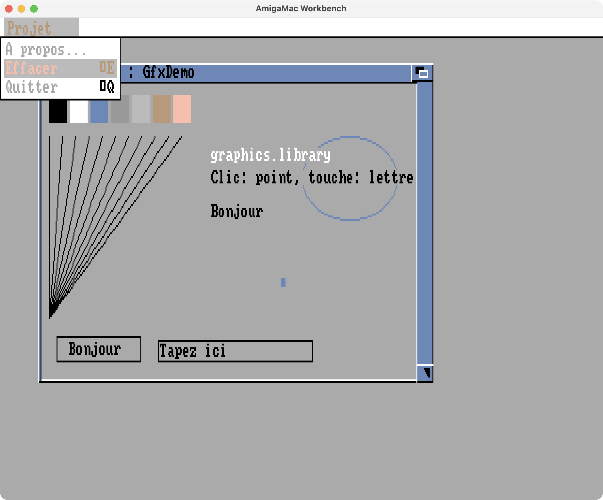

# AmigaMac

AmigaOS réécrit de zéro en application macOS native. Pas d'émulateur :
l'OS (exec, dos, Shell…) est du code natif ARM/Intel. Seul le **processeur 68k**
est interprété, pour exécuter les vrais programmes Amiga.



## Architecture

```
 programme Amiga 68k ──JSR -n(A6)──▶ table de vecteurs : $Axxx + RTS
                                                │ (piège A-line)
                                                ▼
 interpréteur 68020 (cpu68k.c) ──▶ fonction native (exec.c, dos.c…)
                                                │
 mémoire 68k (32 Mo, big-endian) ◀──────────────┘  structures Amiga réelles
                                                   (ExecBase, Process, FileHandle…)
 macOS : fichiers (SYS:, RAM:, Mac:), fenêtre AmigaShell (AppKit)
```

- `Sources/CAmiga/cpu68k.c` : interpréteur 68000 + 68020 (sans FPU pour l'instant).
- `Sources/CAmiga/core.c` : mémoire, tas, pièges, listes exec, création des bibliothèques.
- `Sources/CAmiga/fdtables.c` : **généré** depuis les `.fd` du NDK (`tools/genfd.py`).
  Les 76 bibliothèques ont leurs 1 292 vecteurs aux bons offsets. Une fonction non
  encore écrite affiche son nom (`fonction non implémentée : dos.Foo`).
- `Sources/CAmiga/sched.c` : l'ordonnanceur d'exec (voir plus bas).
- `Sources/CAmiga/exec.c`, `dos.c`, `timer.c` : les bibliothèques et périphériques natifs.
- `Sources/CAmiga/shell.c` : le Shell et ses commandes intégrées.
- `Sources/AmigaMac/main.swift` : l'application macOS.
- `Sources/amigarun` : la même chose en ligne de commande (tests, scripts).

Méthode : réécriture propre, d'après l'ABI publique (NDK, Autodocs). Le code de
la ROM Kickstart n'est jamais recopié.

## Multitâche

Chaque tâche Amiga a son thread macOS et son propre contexte 68k, mais un seul
s'exécute à la fois : il détient le « bâton » (verrou global). L'exécution reste
donc déterministe, sans accès concurrent à la mémoire Amiga. Une fonction native
qui doit attendre (`Wait`, `WaitPort`, `DoIO`, lecture console, `Delay`) passe
simplement le bâton.

- État visible identique à exec : `ThisTask`, listes `TaskReady`/`TaskWait`,
  `tc_State`, signaux, `TDNestCnt`/`IDNestCnt` sauvegardés par tâche.
- Préemption toutes les 20 000 instructions (tourniquet à priorité égale), et
  immédiatement quand un `Signal`/`PutMsg` réveille une tâche plus prioritaire.
  `Forbid`/`Disable` la suspendent ; `Wait` les rompt temporairement, comme sur Amiga.
- Événements extérieurs (échéances du timer.device, lignes tapées, Ctrl-C) : une
  file que l'interface remplit sans jamais prendre le bâton. Un programme qui
  boucle sans fin ne peut pas geler la fenêtre.
- Le Shell est un vrai processus CLI (natif). `RUN` lance un processus CLI en
  arrière-plan, `STATUS` les liste, `BREAK n` (ou Ctrl-C) les interrompt.

Implémentés : `AddTask`/`RemTask`, `Wait`/`Signal`/`SetSignal`, `AllocSignal`,
`SetTaskPri`, ports et messages, sémaphores avec file d'attente, `OpenDevice`,
`DoIO`/`SendIO`/`WaitIO`/`CheckIO`/`AbortIO`, `CreateIORequest`, `timer.device`
(toutes unités, `TR_ADDREQUEST`/`GETSYSTIME`/`SETSYSTIME`, `AddTime`, `SubTime`,
`CmpTime`, `GetSysTime`, `ReadEClock`), `CreateNewProc`/`CreateProc`, `Delay`,
`WaitForChar`.

## Graphisme et Intuition

- **Un écran Amiga = une fenêtre macOS.** Le Workbench (640×256, 8 couleurs) s'ouvre
  à la demande ; les écrans personnalisés (`OpenScreen`) ouvrent leur propre fenêtre.
  Affichage environ 50 fois par seconde, et seulement quand quelque chose a changé ;
  pixels nets (plus proche voisin), rapport d'aspect respecté.
- **Chaque fenêtre a sa bitmap**, composée à l'affichage dans l'ordre de profondeur :
  aucune fenêtre n'est jamais abîmée (comportement `SMART_REFRESH` parfait), donc
  `layers.library` reste minimale.
- **graphics.library** travaille sur de vraies bitmaps planaires en mémoire 68k :
  pixels, lignes à motif, rectangles à motif, `Area*` (polygones et ellipses remplis),
  ellipses, `BltBitMap` (tous minterms), `ClipBlit`, `BltTemplate`, `ScrollRaster`,
  `Flood`, texte générique (`tf_CharData`/`tf_CharLoc`), couleurs 4 et 32 bits,
  stylos, pixels chunky, `WaitTOF`, régions.
- **Police système** : `fonts/amiga8.txt`, une police 8×8 dessinée pour AmigaMac
  dans l'esprit de topaz (la topaz de la ROM est sous copyright), accents Latin-1
  composés automatiquement (`tools/genfont.py`).
- **Intuition** : écrans, fenêtres et décorations Workbench 2/3 (fermeture, profondeur,
  taille, barre de déplacement), activation, IDCMP (`CLOSEWINDOW`, `MOUSEBUTTONS`,
  `MOUSEMOVE`, `RAWKEY`, `VANILLAKEY`, `GADGETUP/DOWN`, `MENUPICK`, `NEWSIZE`,
  `CHANGEWINDOW`, `ACTIVE/INACTIVEWINDOW`, `INTUITICKS`), gadgets booléens, chaîne
  (édition au clavier) et proportionnels, menus (sous-menus, `CHECKIT`, exclusion
  mutuelle, raccourcis Amiga), `EasyRequest`/`AutoRequest`/`BuildEasyRequest`,
  `DrawBorder`/`DrawImage`/`PrintIText`. La tâche `input.device` (priorité 20)
  traite souris et clavier comme sur Amiga.
- Les décalages de structures viennent de `include/ndk_offsets.h`, **généré par le
  compilateur Amiga (vbcc) exécuté dans AmigaMac** à partir des en-têtes officiels
  (`Tests/c/offsets.c`).

Pas encore fait : `GIMMEZEROZERO`, couches créées par les programmes, polices sur disque.

## Workbench et bibliothèques d'interface

- **Le Workbench** démarre au lancement (`S:Startup-Sequence` contient `LoadWB`).
  C'est un processus natif écrit pour AmigaMac, qui passe par les vraies fonctions
  d'intuition, gadtools et asl : bureau avec les volumes (System, Ram Disk, Mac),
  tiroirs avec ascenseur, affichage par icônes ou par nom, « Icônes seulement » /
  « Tous les fichiers », sélection par clic, Maj-clic et lasso, glisser-déposer
  (réorganiser, déplacer dans un tiroir, déposer sur un outil ou une AppWindow),
  double-clic. Menus Workbench / Fenêtre / Icônes / Outils : exécuter une commande,
  nouveau tiroir, parent, ranger, copier, renommer, informations, figer, supprimer,
  lancer un programme (sélecteur ASL), etc. Les programmes sont lancés comme sur Amiga :
  processus sans CLI qui reçoit un message `WBStartup`, rendu à la fin et nettoyé.
  Un fichier du Mac sans outil Amiga s'ouvre avec son application macOS.
- **workbench.library** : AppWindow, AppIcon, AppMenuItem (messages `AppMessage`),
  `OpenWorkbenchObject`, `UpdateWorkbench`, `WBInfo`.
- **icon.library** : lecture et écriture du format `.info` (DiskObject, images
  planaires, outil par défaut, ToolTypes, données de tiroir), icônes par défaut
  dessinées pour AmigaMac (`fonts/icons.txt` → `tools/genicons.py`), `FindToolType`,
  `MatchToolValue`, `BumpRevision`, `DrawIconState`, `GetIconTagList`…
- **BOOPSI** : vraies structures `IClass`/`_Object`, sous-classes 68k (dispatchers en
  C Amiga avec `DoSuperMethodA`), classes système `rootclass`, `imageclass`,
  `frameiclass`, `sysiclass`, `itexticlass`, `fillrectclass`, `gadgetclass`,
  `buttongclass`, `frbuttonclass`, `propgclass`, `strgclass`, `groupgclass`,
  `icclass`, `modelclass`, notifications `ICA_TARGET` (jusqu'à `IDCMPUPDATE`).
- **gadtools.library** : tous les types (bouton, case, entier, liste, MX, nombre,
  cycle, palette, ascenseur, curseur, chaîne, texte, générique) avec leurs messages
  IDCMP, `GT_Set/GetGadgetAttrs`, `CreateMenus`/`LayoutMenus` (sous-menus, barres,
  `GTMENUITEM_USERDATA`), `DrawBevelBox`, `GetVisualInfo`.
- **asl.library** : sélecteur de fichiers (motif, tiroir, fichier, volumes, parent,
  double-clic, filtres `AcceptPattern`/`RejectIcons`…), de police et de mode d'écran.
- **utility.library** (étiquettes, hooks, dates, arithmétique 32/64 bits) et motifs
  AmigaDOS (`#?`, `(a|b)`, `~`, `[a-z]`) dans `ParsePattern`/`MatchPattern`.

## Compatibilité (jalon 5)

- **FPU 68881/68882** dans l'interpréteur : toutes les opérations arithmétiques et
  transcendantes, formats entier/simple/double/étendu/décimal BCD, `FMOVEM`, `FBcc`,
  `FScc`, `FDBcc`, `FTRAPcc`, registres de contrôle, modes d'arrondi, `FSAVE`/`FRESTORE`
  (trame nulle). Les registres sont des doubles de l'hôte (53 bits de mantisse au lieu de 64).
- **Bibliothèques mathématiques** : mathieeedoubbas/trans, mathieeesingbas/trans,
  mathffp/mathtrans (format FFP de Motorola).
- **Consoles** : fenêtres `CON:`/`RAW:` ouvertes par `Open()` (options CLOSE, WAIT,
  NOSIZE…), séquences de contrôle de la console Amiga (CSI : curseur, effacement,
  insertion, couleurs, rapport de taille), édition de ligne, Ctrl-C/D/E/F, `SetMode`,
  `WaitForChar` ; console.device (lectures asynchrones, ConUnit) ; keymap.library
  (`MapRawKey`, `MapANSI`) qui apprend la disposition réelle du clavier Mac.
  `NEWSHELL` ouvre un Shell dans une fenêtre (aussi dans le menu Outils du Workbench).
- **locale.library** : langue déduite des préférences macOS (français ou anglais
  intégrés), vrais catalogues IFF CTLG dans `PROGDIR:Catalogs/` et `LOCALE:Catalogs/`,
  `FormatString` (avec `%n$`), `FormatDate`, `ParseDate`, classes de caractères et
  comparaisons Latin-1. `PROGDIR:` désigne le répertoire du programme en cours.
- **diskfont.library** : vraies polices bitmap Amiga de `FONTS:` (`.font` + fichiers
  hunk), `AvailFonts`, `NewFontContents`. Une police `amigamac.font` 16 points est
  fournie (`tools/gendiskfont.py`).
- **iffparse.library** (lecture et écriture, propriétés, collections, flux DOS ou hook),
  **datatypes.library** (images ILBM dessinées dans les fenêtres, sons 8SVX joués),
  **audio.device** et sortie son macOS (mélangeur 16 voix sur AudioQueue),
  **clipboard.device** relié au presse-papiers du Mac (texte FTXT, unité 0),
  **rexxsyslib.library** (messages et chaînes ARexx, sans interpréteur).
- Divers : base de données des modes d'affichage (`GetDisplayInfoData`…), `BitMapScale`,
  `StackSwap`, fenêtres `GIMMEZEROZERO`, piles superviseur, noms de fichiers Latin-1 ↔
  UTF-8 (y compris les accents décomposés de macOS), glyphes Latin-1 manquants dessinés.
- **dos.library complète** (hors fonctions privées) : `ExAll`, `MatchFirst`/`MatchNext`,
  `ReadItem`/`FindArg`/`SplitName`, bits de protection et commentaires (gardés en
  attributs étendus macOS), `SetFileDate`, `SetFileSize`, liens, liste DOS
  (`LockDosList`/`NextDosEntry`…), assigns, `RunCommand`, `SystemTagList`, `Execute`,
  paquets DOS (`DoPkt`, `SendPkt`…), `VFWritef` au format BCPL. `ReadArgs` rend à un
  argument `/A` les derniers mots pris par un `/M` qui le précède, comme AmigaOS.
- **Shell** : variables locales (`SET`, `$var`, `${var}`, `$RC`, ENV:), substitution
  `` `commande` ``, `PATH`, motifs dans `DIR`/`LIST`, et des scripts complets :
  `.KEY`/`.DEF`/`.BRA`/`.KET`, `IF`/`ELSE`/`ENDIF` (`EXISTS`, `WARN`, `EQ`, `GT`, `VAL`,
  `NOT`…), `SKIP`/`LAB`, `QUIT`, `FAILAT`, `ASK`, `WHICH`, `PROTECT`. Un script portant
  le bit S se lance par son nom.
- **Résolution du Workbench** : le programme **Prefs/ScreenMode** (un vrai programme
  68k GadTools, source dans `Prefs/screenmode.c`) liste la base des modes d'affichage
  (PAL basse, haute et super-haute résolution, entrelacés ou non, et des modes
  « AmigaMac: » à pixels carrés de 800x600 à 1920x1080, comme une carte graphique) et
  le nombre de couleurs. « Utiliser » écrit `ENV:Sys/screenmode.prefs` (jusqu'au
  prochain lancement), « Sauver » aussi `ENVARC:Sys/`. Le Workbench se rouvre aussitôt
  dans le nouveau mode avec ses tiroirs, comme le fait IPrefs, sauf si d'autres
  programmes ont encore des fenêtres sur l'écran. `SA_LikeWorkbench` suit ce mode.
- **Pour Directory Opus** : `exec.Allocate`/`Deallocate` (régions mémoire privées),
  `InitStruct` réaligné après un octet, une vraie `RootNode`/`DosInfo` dont la liste
  DOS (triée) suit les assigns, **keyboard.device** (matrice des touches),
  **input.device** avec la chaîne des gestionnaires d'entrée 68k (chaque événement les
  traverse avant Intuition, `IND_WRITEEVENT`, `PeekQualifier`), requêtes à l'ancienne
  `Request`/`EndRequest`, `SetABPenDrMd`, `InitGels`, `PubScreenStatus`.
  `S:User-Startup` est exécuté au démarrage s'il existe (assigns des logiciels installés).
- **reqtools.library** (v38) : requêtes de fichier, de police et de mode d'écran (par
  asl.library), messages (`rtEZRequestA`, par EasyRequest), saisie d'une chaîne ou d'un
  nombre (`rtGetStringA`, `rtGetLongA`), gestionnaires de requête (`RT_ReqHandler`),
  verrouillage des fenêtres, `rtSpread`, `rtSetReqPosition`. ReqToolsBase porte les
  bases d'Intuition, graphics, dos, gadtools et utility, que les programmes y lisent.
- **commodities.library** : brokers (unicité, `CXCMD_UNIQUE`, `CXCMD_LIST_CHG`), objets
  filtre, émetteur, signal, traduction et personnalisé, descriptions de raccourcis
  (`ParseIX` : « ctrl alt d », « rawmouse lbutton », « -upstroke f1 »…), `MatchIX`,
  `InvertKeyMap`, `AddIEvents`. Le réseau est dans le flux d'entrée à la priorité 53,
  avant Intuition ; les événements traduits prennent la place de l'original. La
  commande `EXCHANGE` du Shell liste les commodités et leur envoie SHOW, HIDE, ENABLE,
  DISABLE ou KILL (l'Exchange d'AmigaOS passe par des fonctions privées).
- **Pointeur** : celui d'Amiga devient le curseur du Mac au-dessus des écrans —
  `SetPointer`/`ClearPointer`, pointeur d'attente (`WA_BusyPointer`, `SetWindowPointerA`),
  et le sprite 0 (`GetSprite`/`ChangeSprite`/`FreeSprite`) que prennent les économiseurs
  pour le cacher. input.device produit lui-même ses événements temporels (10 par seconde).
- **Apparence inspirée d'AmigaOS 3.2** : palette claire (fenêtres gris-bleu, cadre et
  barre de titre bleus pour la fenêtre active, bureau gris clair, barre d'écran bleu
  pâle), gadgets dessinés à la manière de 3.x (fermeture, zoom, profondeur, taille),
  gadget de zoom (`WA_Zoom`, `ZipWindow`), tiroirs avec ascenseurs vertical et
  horizontal et leurs flèches groupées en bas à droite (répétition tant qu'on appuie),
  volumes en colonne à gauche, 1280x720 par défaut.
- **Icônes en couleurs** : icon.library lit le format couleur d'AmigaOS 3.5+ (bloc IFF
  `FORM ICON`, morceaux `FACE` et `IMAG`, images et palettes compressées RLE), le garde
  à l'écriture, et le Workbench (256 couleurs par défaut) les affiche en attribuant à
  chaque couleur un stylo de l'écran (exact s'il en reste, sinon le plus proche). Les
  icônes par défaut viennent de `ENV:Sys/def_*.info` (copiés d'ENVARC: au démarrage),
  comme sur AmigaOS. Un jeu d'icônes AmigaMac original est dessiné par
  `tools/mkicons.py` : tiroir, disque, Ram Disk, Mac, corbeille, outil, document, Shell,
  ScreenMode ; chaque fichier garde aussi une image classique 4 couleurs.
- **Polices (Prefs/Font)** : SYS:Prefs/Font choisit, comme sur AmigaOS, la police des
  icônes du Workbench, celle du texte système (chasse fixe : Shells, console,
  `GfxBase->DefaultFont`) et celle de l'écran (barres de titre, menus, requêtes, fenêtres,
  gadgets GadTools) ; « Utiliser » écrit `ENV:Sys/font.prefs`, « Sauver » aussi
  `ENVARC:Sys/font.prefs`, et le Workbench se rouvre aussitôt avec elles. « Ajouter des
  polices… » copie dans FONTS: une police bitmap Amiga (`nom.font` et le tiroir de ses
  tailles) ou toutes celles d'un tiroir, d'une disquette par exemple (une archive LhA
  s'extrait d'abord par le menu du Workbench). La requête de police d'asl.library liste
  les vraies polices de FONTS: avec leurs tailles et un aperçu (chasse fixe seulement
  si demandé). Intuition, GadTools, la console et le Workbench mesurent leurs textes dans
  la police en usage, proportionnelle ou non. Deux familles d'origine sont fournies,
  tirées de la police 8×8 d'AmigaMac par `tools/gendiskfont.py` : amigamac 8 et 16
  (chasse fixe) et amigasans 8 et 16 (proportionnelle).
- **Disquettes (.adf)** : une image de disquette Amiga (880 Ko, ou 1,76 Mo pour une
  haute densité) se met dans DF0: à DF3: par le menu Disquettes du Mac (⌘D insérer,
  ⌘E éjecter), en la glissant sur l'écran Amiga, en l'ouvrant depuis le Finder, ou par
  `DISKIMAGE DF0: fichier.adf` (`DISKIMAGE DF0: EJECT`). Le système de fichiers
  d'AmigaDOS y est lu (OFS et FFS, noms internationaux, caches de répertoires) : son
  contenu, avec dates, bits de protection et commentaires, devient le volume DF0: et le
  volume au nom de la disquette, visibles du Workbench (icône de disquette, place
  occupée sur la disquette), de `Info()`, de la DosList ; les fenêtres qui le demandent
  reçoivent IDCMP_DISKINSERTED/REMOVED. À l'éjection, et quand AmigaMac se termine,
  une disquette modifiée est réécrite dans son image (même bloc d'amorce, même système
  de fichiers ; les caches de répertoires ne sont pas recréés). Si son contenu ne tient
  plus sur une disquette, l'image n'est pas touchée et le journal dit où il est gardé.
  Les disquettes non AmigaDOS (jeux à chargeur de pistes) ne se lisent pas : rien ne
  reproduit le lecteur de disquettes lui-même.
- **GlowIcons et NewIcons** : les GlowIcons (format d'AmigaOS 3.5 ci-dessus) et les
  NewIcons, plus anciennes, codées dans les types d'outil `IM1=`/`IM2=`, s'affichent en
  couleur, avec leur image sélectionnée, comme avec l'icon.library d'OS 3.5.
  `IconControlA` donne aux programmes les images, palettes, couleur transparente,
  masques, dimensions et options (`ICONCTRLA_…`). Une icône modifiée par un programme
  est réécrite au format OS 3.5 par `PutDiskObject`. Dans un tiroir, les icônes sans
  position prennent les places que laissent libres les icônes placées. Le jeu de
  GlowIcons d'AmigaOS n'est pas fourni (il n'est pas libre) ; celles des logiciels
  installés s'affichent. Test : `GlowTest icône [copie]`.
- **Couleurs vraies (comme une carte graphique)** : les modes « AmigaMac: » vont
  jusqu'à 24 bits (16 millions de couleurs), le Workbench y est par défaut. La
  bibliothèque graphique a un second type d'image, en couleurs vraies (32 bits par
  point) ; les programmes qui dessinent avec des stylos continuent de marcher (les
  stylos passent par la palette de l'écran), les copies convertissent entre les deux
  types. **cybergraphics.library** (v41) donne aux programmes l'accès direct :
  `WritePixelArray`, `ReadPixelArray`, `WriteLUTPixelArray`, `ScalePixelArray`,
  `Read`/`WriteRGBPixel`, `FillPixelArray`, `LockBitMapTagList`, `GetCyberMapAttr`,
  `BestCModeIDTagList`, liste des modes… ScreenMode propose 16 et 24 bits. Visage
  affiche ainsi une image ILBM 24 bits sans perte. La mémoire Amiga passe à 256 Mo.
  Les modes PAL restent à 256 couleurs, comme sur un vrai Amiga.
- **Puces de l'Amiga, pour les programmes qui les pilotent eux-mêmes** : l'OS reste
  natif, mais les trackers, jeux et démos contournent le système et programment
  directement le matériel. AmigaMac reproduit donc ce que font ces registres
  (`chipset.c`, `audio.c`, `cia.c`, d'après la documentation publique du matériel) :
  - **Paula** : les 4 voies son (registres `$DFF0A0`–`$DFF0DF`, DMACON, INTENA,
    INTREQ ; échantillons lus en mémoire Amiga, rebouclage, mode manuel `AUDxDAT`,
    interruptions audio au début de chaque bloc), mixées vers le son du Mac ;
  - les minuteurs des deux **CIA** (`ciaa`/`ciab.resource`, AddICRVector, AbleICR,
    SetICR, horloge E à 709 379 Hz) ;
  - le **copper** (MOVE, WAIT, SKIP, COPJMP), exécuté ligne par ligne cinquante fois
    par seconde, avec les changements de couleurs en cours de ligne ;
  - les **plans de bits** : 1 à 6 plans, basse ou haute résolution, double champ de
    jeu, demi-teinte (EHB), HAM, fenêtre d'affichage, décalages, modulos ;
  - les 8 **sprites** (DMA, paires attachées) ;
  - le **blitter**, exécuté d'un coup à l'écriture de `BLTSIZE` : 4 canaux,
    décalages, masques, mintermes, mode descendant, remplissage, tracé de lignes ;
  - les entrées : bouton de la souris sur le CIA-A, compteurs `JOY0DAT`.

  Une tâche d'interruption appelle le code 68k des programmes comme exec le fait
  (A0 = `$DFF000`, A1 = données) : minuteurs CIA, interruptions logicielles
  (`Cause`), temps mort vertical (`AddIntServer`, 50 Hz), copper, audio
  (`SetIntVector`). Dès qu'un programme installe sa propre liste copper, son image
  s'affiche dans une fenêtre Mac à part ; elle se ferme quand il remet la liste du
  système (`GfxBase->copinit`) ou se termine. Le pointeur du Mac y est masqué : le
  sprite du programme le remplace : les mouvements du Mac lui parviennent en relatif,
  puis, une fois la souris et le sprite immobiles, le gain du programme est mesuré
  et un dernier mouvement ramène le sprite sous la souris. Ce n'est pas exact au cycle près.
  `AMIGAMAC_HW=1` journalise les voies son qui démarrent.
- **Fond et organisation** : le Workbench lit `ENV:Sys/wbpattern.prefs` (format
  WBPattern, image en mosaïque, centrée ou à l'échelle) et affiche l'image nommée
  derrière le bureau ; le fond AmigaMac (dégradé et nom, dessin original) est produit
  par `tools/mkbackdrop.py`. Le disque System a les tiroirs d'AmigaOS 3.2 (System,
  Storage, WBStartup, Expansion…) avec des icônes à emblème, et une **Corbeille** : on y
  dépose des icônes, *Icônes → Vider la corbeille* la vide après confirmation. Les
  programmes placés dans `SYS:WBStartup` démarrent avec le Workbench.
- **Barres d'information** : la barre d'écran du Workbench donne chaque seconde la
  mémoire libre, le processeur, le nombre de tâches, la date et l'heure ; la fenêtre
  d'un volume affiche son remplissage (« System 28 % plein, 670,2 Go libres… », chiffres
  réels du disque du Mac ; pour Ram Disk, ce qu'il contient).
- **Icône Shell** dans le tiroir `SYS:System`, à sa place sur AmigaOS : un double-clic
  ouvre une fenêtre Shell (programme 68k `Programs/shell.c`, icône dessinée dans
  `fonts/shell_icon.txt` et produite par `tools/mkinfo.py`).
- **Extraire une archive depuis le Workbench** : sélectionner un fichier `.lha` ou `.lzh`,
  puis *Outils → Extraire l'archive (LhA)* (Amiga-X) ; `C:LhA` l'extrait dans un tiroir du
  même nom, sa progression dans une fenêtre console. LhA n'est pas livré avec AmigaMac :
  il se télécharge sur Aminet (`util/arc/lha_68k.lha`). Les redirections du Shell
  acceptent `>CON:…` et `>NIL:`.
- **Registres matériels lus** : les programmes qui interrogent directement le CIA
  (bouton gauche) ou `POTGOR` (bouton droit) et la position du faisceau obtiennent des
  valeurs cohérentes ; la plage matérielle `$A00000-$FFFFFF` n'est plus de la RAM.

### Logiciels Aminet essayés

| Logiciel | Type | État |
|---|---|---|
| Compute 45.2 (misc/math) | calculatrice Shell, 3 variantes (IEEE double, simple, FFP) | fonctionne |
| Calculator 1.3 (misc/math) | calculatrice GadTools, locale | fonctionne |
| Boum 1.2 (game/wb) | démineur, datatypes (sons), fenêtre GZZ, mise à l'échelle | jouable |
| BenchClock 1.60 (util/time) | horloge Workbench, timer.device | fonctionne |
| MegaED 1.2 (text/edit) | éditeur multi-tâches, ARexx, presse-papiers | fonctionne (aide amigaguide/hothelp absente) |
| Visage 39.22 (gfx/show) | visionneuse d'images (datatypes, paquets DOS) | fonctionne |
| P-View (gfx/show) | visionneuse ILBM, lit le CIA directement | fonctionne |
| ALook 3.1 (gfx/show) | visionneuse, charge sa propre iff.library depuis LIBS: | fonctionne |
| Fifteen-Game 3 (game/think) | taquin GadTools | se lance et s'affiche (partie complète non testée) |
| 4Wins (game/think) | puissance 4 | se lance et s'affiche (partie complète non testée) |
| 521 (game/think) | jeu de réflexion | se lance et s'affiche (partie complète non testée) |
| Amtris (game/think) | Tetris | demande powerpacker.library (tierce, non fournie) |
| 0Filters 1.0 (util/cli) | 18 filtres Shell (Head, Tail, Uniq, WC, Tee, Strings, Encode…) | fonctionnent tous |
| Directory Opus 4.12 (util/dopus) | gestionnaire de fichiers, sa propre dopus.library | fonctionne (listes, Makedir, visionneuse) ; disquettes absentes |
| LhA 2.15 (util/arc) | archiveur, installé dans `C:LhA` | fonctionne (liste, extraction, dates conservées) |
| NewShellCX 1.07 (util/cdity) | commodité, Shell sur raccourci | fonctionne (Amiga gauche + Échap) |
| MouseBlanker 1.21 (util/cdity) | commodité, cache le pointeur | fonctionne (sprite 0) |
| Spliner 1.7 (util/cdity) | commodité, économiseur d'écran | fonctionne (veille et réveil) |
| KeyCall 1.3.2 (util/cdity) | raccourcis de lancement (gestionnaire d'entrée) | se lance |
| ProTracker 3.15 (mus/edit) | tracker | fonctionne : interface (copper, blitter, sprites), souris, page disque, chargement et lecture des modules |
| DigiBooster 1.7 (mus/edit) | tracker 8 voies | fonctionne : interface, souris, pages (sampler), confirmation de sortie |
| HippoPlayer 2.45 (mus/play) | lecteur de modules | fonctionne : fenêtre, liste, lecture des modules par Paula et les minuteurs CIA (reqtools.library) |
| 0Utils (util/cli) | 25 commandes Shell pour scripts (Open/ReadLn/WriteLn, SRun, Exists…) | fonctionnent, sauf `Window` (binaire défectueux dans l'archive) |

Corrigé en chemin : pile superviseur des tâches, `CreateMsgPort` qui laisse le port
dans A0 comme la ROM, un nouveau processus qui démarre avant que son parent continue
(comme sur une vraie machine, où la tranche de temps du parent s'écoule), bitmaps de
fenêtres qui ne changent plus d'adresse au redimensionnement.

Outils de mise au point : `AMIGAMAC_TRACE=1` journalise chaque appel système (arguments,
résultat), les adresses de chargement des hunks et les 32 dernières instructions avant
une faute ; `AMIGAMAC_MUTE=1` coupe le son (par défaut dans `amigarun`) ;
`AMIGAMAC_LANG=fr|en` force la langue.

## Construire et lancer

```bash
tools/makeapp.sh && open build/AmigaMac.app
```

Le dossier système est créé au premier lancement dans
`~/Library/Application Support/AmigaMac/System` (`AMIGAMAC_SYS` pour en choisir un autre).
`SYS:` = ce dossier, `RAM:` = un sous-dossier temporaire, `Mac:` = tout le disque du Mac.

En ligne de commande :

```bash
swift build && .build/debug/amigarun System "Hello Claude LOUD"
```

## Tests

- `tools/cpucheck.sh 1000000` : compare l'interpréteur à Musashi (cœur 68k sous licence MIT,
  téléchargé dans `tools/oracle`, outil de test uniquement), une instruction aléatoire à la
  fois : registres, drapeaux, mémoire, cadres d'exception. Résultat : 0 différence sur
  4 × 1 000 000 d'instructions. Sont exclus les cas où Musashi s'écarte du manuel Motorola
  et de WinUAE (`PACK`/`UNPK` en mémoire, `CHK2`/`CMP2`), et le bit M (pile maître,
  inutilisé sur Amiga).
- `Tests/asm/hello.s` : vrai exécutable Amiga (hunk). Il utilise `Write`, `PutStr`,
  `VPrintf`/`RawDoFmt` et `ReadArgs`.
- `Tests/asm/tasks.s` (`TaskTest`) : messages entre tâches, préemption de deux
  tâches qui ne cèdent jamais, attente timer.device de 300 ms mesurée,
  `CreateNewProc`, sémaphore disputé. 20 exécutions sur 20 réussies.
- `Tests/asm/spin.s` (`Spin`) : un point toutes les 0,1 s, s'arrête sur Ctrl-C.
  Sert à tester `RUN`, `STATUS` et `BREAK`.
- Programmes C compilés pour Amiga avec vbcc (`tools/vcc`, outil de développement) :
  `Tests/c/gfxdemo.c` (fenêtre, dessin, bouton, champ texte, menus, requêtes),
  `screendemo.c` (écran 32 couleurs), `idcmplog.c` (affiche chaque message IDCMP),
  `hello.c`, `offsets.c`, `boopsitest.c` (sous-classe 68k de `buttongclass`, notifications),
  `gtdemo.c` (tous les gadgets et menus GadTools), `icontest.c` (aller-retour `.info`,
  ToolTypes, icônes par défaut), `asltest.c` (sélecteurs fichier, police, mode d'écran),
  `wbapp.c` (AppWindow, AppIcon, AppMenuItem, `OpenWorkbenchObject`), `fputest.c`
  (compilé pour la FPU et pour `mieee.lib` : sortie identique à la version Mac),
  `contest.c` (fenêtre CON:), `loctest.c`, `fonttest.c`, `ifftest.c` ; en assembleur
  `fpu.s` (FMOVEM, formats étendu et BCD, FDBcc…) et `ffp.s` (mathffp).
- Le Workbench se teste aussi sans interface :
  `amigarun System "loadwb" "wait 2" "input click 62 44" "input click 62 44" "snapshot RAM:wb.ppm"`.
- Commandes de test du Shell : `INPUT` injecte souris/clavier, `SNAPSHOT` écrit
  l'image de l'écran actif (PPM), `WAIT`. Les interactions se scénarisent sans interface :
  `amigarun System "run GfxDemo" "wait 1" "input click 300 140" "snapshot RAM:a.ppm"`.

## Feuille de route

| Jalon | Contenu | État |
|---|---|---|
| 1. Socle | CPU 68k, mémoire, pièges, exec/dos de base, LoadSeg, Shell, app macOS | fait |
| 2. Multitâche | ordonnanceur exec (tâches, signaux, Wait, ports, sémaphores, I/O), CreateNewProc, RUN, timer.device | fait |
| 3. Graphisme | graphics, layers, intuition : écrans et fenêtres dans macOS, IDCMP, gadgets, menus, requêtes | fait |
| 4. Workbench | icon.library, Workbench (icônes, tiroirs, menus), BOOPSI, gadtools, asl | fait |
| 5. Compatibilité | FPU 68881/2, math, consoles, locale, diskfont, iffparse, datatypes, son, presse-papiers, dos.library complète, scripts du Shell, logiciels Aminet | en cours (deux lots faits) |
